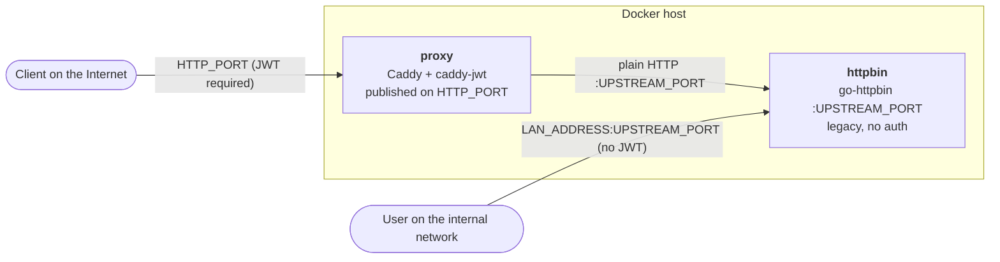
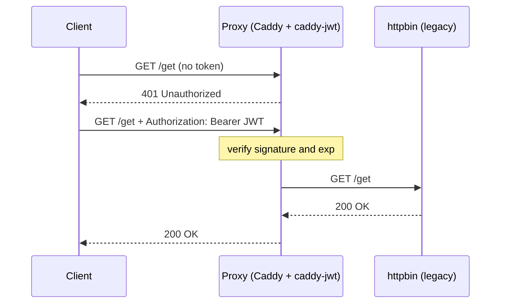

# تمرین دوم عملی – پروکسی معکوس HTTP با احراز هویت JWT

## معماری



## روند ارسال درخواست



## اجرا

```
make up
make test
PORT=$(sed -n 's/^HTTP_PORT=//p' .env)
curl -i localhost:$PORT/get                                              # 401 - بدون توکن
curl -i -H "Authorization: Bearer $(make -s token)" localhost:$PORT/get  # 200 - عبور از پروکسی
make down
```

همهٔ پورت‌ها و آدرس‌ها از فایل `.env` خوانده می‌شوند (`HTTP_PORT` و `UPSTREAM_PORT` و `LAN_ADDRESS`)، و هیچ‌کدام در کد یا README ثابت نوشته نشده‌اند.

## دسترسی مستقیم از شبکه داخلی

سرویس قدیمی علاوه بر پروکسی، روی آدرس `LAN_ADDRESS` و پورت `UPSTREAM_PORT` هم منتشر می‌شود تا کاربران شبکه داخلی بدون JWT به آن دسترسی داشته باشند. مقدار پیش‌فرض `LAN_ADDRESS` برابر `127.0.0.1` است (فقط خود میزبان)، پس آن را روی آدرس میزبان در شبکه داخلی بگذارید، مثلاً `192.168.1.10`.

هیچ‌وقت آن را روی `0.0.0.0` نگذارید، چون سرویس بدون احراز هویت روی اینترنت هم باز می‌شود.

## نکات طراحی (سؤال ۳)

- انتخاب پروکسی: از Caddy همراه ماژول `caddy-jwt` استفاده شده است، به‌جای اینکه پروکسی از ابتدا نوشته شود. در Caddy به‌صورت پیش‌فرض JWT وجود ندارد، پس در `Dockerfile` با `xcaddy` ساخته می‌شود.
- شرایط احراز هویت: درخواست باید هدر `Authorization: Bearer <JWT>` با امضای معتبر HS256 و `exp` منقضی‌نشده داشته باشد. در غیر این صورت پاسخ 401 است و درخواست به سرویس قدیمی نمی‌رسد.
- استفاده صرفاً از هدر: توکن از Query String یا Cookie پذیرفته نمی‌شود، چون URLها در لاگ‌ها ثبت می‌شوند. دستور `make test` این را بررسی می‌کند.
- مدیریت کلید: کلید امضا به‌صورت Base64 در فایل `.env` نگهداری می‌شود (قالب موردنیاز `caddy-jwt`) و با `.gitignore` به Git اضافه نمی‌شود.
- صدور توکن: صورت‌مسئله فقط احراز هویت در پروکسی را خواسته است، پس دستور `make token` نقش صادرکنندهٔ توکن را بازی می‌کند. در محیط واقعی بهتر است توکن توسط یک Identity Provider و با الگوریتم نامتقارن مثل RS256 امضا شود.
- دسترسی از اینترنت و شبکه داخلی: از اینترنت فقط پروکسی در دسترس است. سرویس قدیمی فقط روی `LAN_ADDRESS` منتشر می‌شود (نه `0.0.0.0`) تا کاربران داخلی بدون توکن به آن برسند.

## سؤال اول (۵ نمره) – چگونه می‌توان یک سرویس را فقط در شبکه داخلی اجرا کرد؟

هدف این است که سرویس هیچ مسیری برای دسترسی از اینترنت نداشته باشد. برای رسیدن به این هدف می‌توان چندین لایه امنیتی را با یکدیگر ترکیب کرد:

1. اتصال به یک رابط شبکه خصوصی به‌جای `0.0.0.0`: سرویس باید روی آدرس `127.0.0.1` (در همان میزبان) یا آدرس خصوصی میزبان (برای مثال `10.0.0.5`) گوش دهد. سوکتی که به یک آدرس خصوصی متصل شده باشد، بسته‌های ورودی از رابط عمومی را دریافت نمی‌کند. برای go-httpbin می‌توان از دستور زیر استفاده کرد:

   `-host 127.0.0.1 -port $UPSTREAM_PORT`
2. استفاده از فایروال: ترافیک ورودی به آن پورت را از خارج از زیرشبکه داخلی مسدود کنید (با استفاده از `nftables`، `iptables`، `ufw` یا Security Groupهای سرویس‌های ابری).
3. جداسازی در سطح شبکه: سرویس را در یک زیرشبکه خصوصی یا VLAN قرار دهید که آدرس IP عمومی و NAT یا Port Forward ورودی نداشته باشد.
4. منتشر کردن پورت فقط روی آدرس خصوصی: در Docker، پورت را همراه با آدرس منتشر کنید (در این پروژه از `LAN_ADDRESS` در `.env` می‌آید):

   `$LAN_ADDRESS:$UPSTREAM_PORT:$UPSTREAM_PORT`

   استفاده از دستور ساده `-p $UPSTREAM_PORT:$UPSTREAM_PORT` باعث اتصال پورت به تمام رابط‌های شبکه می‌شود. همچنین قوانین iptables مربوط به Docker ممکن است محدودیت‌های `ufw` را دور بزنند؛ در نتیجه ممکن است سرویس ناخواسته در معرض اینترنت قرار بگیرد.
5. استفاده از Unix Domain Socket یا VPN: پروکسی و سرویس می‌توانند از طریق یک فایل سوکت مشترک با یکدیگر ارتباط برقرار کنند؛ یا می‌توان از VPN استفاده کرد تا فقط اعضای متصل به VPN قادر به دسترسی به شبکه خصوصی باشند.

در نهایت، تنها نقطه ورودی عمومی سیستم، پروکسی معکوس خواهد بود که اجازه دسترسی به سرویس داخلی را دارد.

## سؤال دوم (۵ نمره) – TLS Termination: فلسفه و مفهوم

ایده اصلی: مؤلفه مرزی سیستم (Reverse Proxy یا Load Balancer) مسئول پایان دادن به اتصال TLS است. به این صورت که کلاینت‌ها از طریق HTTPS با پروکسی ارتباط برقرار می‌کنند، پروکسی ترافیک را رمزگشایی می‌کند و سپس آن را از طریق HTTP معمولی به سرویس پشتیبان در شبکه داخلی مورد اعتماد ارسال می‌کند. بنابراین سرویس پشتیبان نیازی به پیاده‌سازی TLS ندارد.

دلایل مناسب بودن این روش برای محافظت از سرویس‌های قدیمی:

- نرم‌افزارهای قدیمی اغلب از TLS پشتیبانی نمی‌کنند (یا فقط از نسخه‌های منسوخ‌شده پروتکل‌ها و الگوریتم‌های رمزنگاری پشتیبانی می‌کنند). قرار دادن یک پشته TLS مدرن (TLS 1.3، الگوریتم‌های رمزنگاری جدید و HTTP/2 یا HTTP/3) در مقابل آن‌ها، بدون نیاز به تغییر نرم‌افزار قدیمی، امنیت ارتباطات را به‌روز می‌کند.
- حفظ محرمانگی و یکپارچگی اطلاعات در بخش غیرقابل‌اعتماد مسیر ارتباطی: تمام اطلاعاتی که از طریق اینترنت منتقل می‌شوند، از جمله JWT ما (که یک اعتبارنامه از نوع Bearer است و در صورت استفاده از HTTP معمولی قابل شنود خواهد بود)، رمزنگاری شده و در برابر دست‌کاری محافظت می‌شوند.
- مدیریت متمرکز گواهی‌ها: دریافت گواهی‌ها، تمدید آن‌ها (Caddy این کار را به‌صورت خودکار از طریق Let's Encrypt انجام می‌دهد) و نگهداری کلیدها در یک نقطه متمرکز انجام می‌شود، نه در تک‌تک سرویس‌ها. همچنین کلیدهای خصوصی روی میزبان‌های سرویس قدیمی قرار نمی‌گیرند.
- امکان پردازش اطلاعات رمزگشایی‌شده توسط پروکسی: از آنجا که پروکسی به متن اصلی درخواست دسترسی دارد، می‌تواند عملیات لایه ۷ را انجام دهد؛ مانند احراز هویت (در این پروژه با JWT)، محدودسازی نرخ درخواست‌ها (Rate Limiting)، ثبت لاگ، مسیریابی و اعمال قوانین WAF. اگر ترافیک رمزنگاری‌شده مستقیماً به سرویس پشتیبان منتقل می‌شد، انجام این عملیات امکان‌پذیر نبود.
- کاهش بار پردازشی و سطح حمله: هزینه پردازشی مربوط به برقراری اتصال و Handshake رمزنگاری بر عهده مؤلفه مرزی قرار می‌گیرد و فقط یک مؤلفه سخت‌سازی‌شده مستقیماً در معرض اینترنت خواهد بود.

محدودیت‌ها و نکات مهم:

پروتکل TLS Termination به‌تنهایی به معنی احراز هویت نیست. این فناوری از کانال ارتباطی محافظت می‌کند، اما هویت درخواست‌دهنده را مشخص نمی‌کند؛ به همین دلیل در این پروژه در کنار JWT استفاده شده است.

همچنین ارتباط بین پروکسی و سرویس پشتیبان رمزنگاری نشده است. این موضوع فقط زمانی قابل قبول است که شبکه داخلی واقعاً مورد اعتماد و ایزوله باشد. در غیر این صورت باید از روش TLS Re-encryption یا Mutual TLS بین پروکسی و سرویس پشتیبان استفاده کرد.

## استفاده از هوش مصنوعی
در جمع‌آوری این پاسخ‌ها، بازنویسی و تمیز کردن کدها، برای مطالعه‌ی بیشتر و بازبینی دانش شخصی و بازبینی جواب نهایی و بعضا بازنویسی آن از هوش مصنوعی استفاده شده است.
محتوای اصلی جواب به صورت دستی تولید شده است. نمودارها با هوش مصنوعی تولید شده‌اند.
